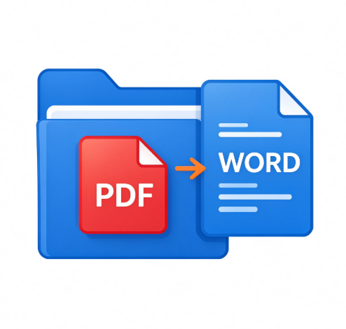

# PDF 转 Word 公文格式转换器

<p align="center">
  
</p>

<p align="center">
  <strong>批量把 PDF 转成 Word，并按 GB/T 9704-2012 自动排版成公文样式。</strong>
</p>

<p align="center">
  <a href="https://github.com/jhtfly/pdf2word-gongwen/releases/latest">下载程序</a> ·
  <a href="#功能特性">功能特性</a> ·
  <a href="#公文格式参数">公文参数</a> ·
  <a href="#命令行批量模式">命令行用法</a> ·
  <a href="#从源码运行">源码运行</a>
</p>

<p align="center">
  
  
  
  
</p>

---

## 项目简介

一款离线运行的桌面工具，解决「PDF 排版固定、无法编辑」与「公文格式要求严格、手工排版费时」两个痛点。拖入 PDF，输出即为已套用公文格式的 `.docx`。

- **全程离线**：文档不出本机，无网络请求、无账号、无用量统计。适合不宜上传外部服务的工作场景。
- **扫描件可识别**：文本型 PDF 直接转换；图片型 PDF 自动调用内置 RapidOCR 识别。
- **三平台可用**：Windows 10/11（64 位）、Windows 7 SP1（32 位程序，兼容 32/64 位系统）、银河麒麟 V10 SP1。

## 三平台版本对比

| 版本 | 运行时 | GUI 框架 | 架构 | 适用系统 | 体积 |
|---|---|---|---|---|---|
| **windows-x64** | Python 3.13 | PyQt6 | 64 位 | Windows 10 / 11 | 146 MB |
| **windows-win7** | Python 3.8.10 | PySide2 5.15.2（Qt 5.15） | 32 位 | Windows 7 SP1（32/64 位）、10、11 | 120 MB |
| **kylin** | Python 3.11（免安装运行时） | PyQt6 | x86_64 | 银河麒麟桌面 V10 SP1（glibc ≥ 2.31） | 351 MB |

> Windows 7 受限于系统 API，只能用 Qt 5.15 与 Python 3.8；Win10 及以上建议使用 `windows-x64` 版本，界面与性能更好。两个 Windows 版共用同一套核心转换逻辑，仅 GUI 层与少量格式化细节不同。

## 下载

前往 [Releases](https://github.com/jhtfly/pdf2word-gongwen/releases/latest) 下载：

| 文件 | 说明 |
|---|---|
| `pdf2word-gongwen-v1.0.0-windows-x64.exe` | Windows 10/11 单文件版，双击即用 |
| `pdf2word-gongwen-v1.0.0-windows-win7.exe` | Win7 兼容版（32 位），双击即用 |
| `pdf2word-gongwen-v1.0.0-kylin.zip` | 麒麟离线部署包，解压后运行 `启动.sh` |

Windows 版为单文件绿色程序，放到任意可写目录即可运行，`config.json` 与 EXE 同目录保存格式参数，可随程序一起拷到其他电脑。

## 功能特性

- **批量转换**：支持多选 PDF 与拖拽导入，队列顺序处理，进度条与状态提示。
- **公文格式化**：转换后自动套用 GB/T 9704-2012 版式（页边距、字体、字号、行距、首行缩进、层次标题、落款右对齐）。
- **标题与层次自动识别**：自动判定大标题，按「一、」「（一）」「1.」三级层次套用黑体/楷体/仿宋。
- **表格处理**：表格文字统一为仿宋小四居中，数字与英文使用 Times New Roman。
- **扫描件 OCR**：无文字层的 PDF 自动走 OCR，纯本地推理。
- **参数可调**：所有格式参数可在界面「格式参数设置」中修改并持久化。
- **命令行模式**：支持无界面批量转换，便于脚本化与定时任务。

## 公文格式参数

程序内置默认值（遵循 GB/T 9704-2012），可在设置界面逐项修改：

| 项目 | 默认值 |
|---|---|
| 页面 | A4 |
| 页边距 | 上 3.7 cm / 下 3.5 cm / 左 2.8 cm / 右 2.6 cm |
| 大标题 | 二号 方正小标宋简体，居中 |
| 正文 | 三号 仿宋_GB2312，两端对齐，首行缩进 2 字符，行距固定值 28 磅 |
| 一级标题（一、） | 三号 黑体 |
| 二级标题（（一）） | 三号 楷体_GB2312 |
| 三级标题（1.） | 三号 仿宋加粗 |
| 落款 | 单位署名与成文日期右对齐，右空二字 |
| 表格 | 仿宋小四居中，数字与英文用 Times New Roman |

> 未安装「方正小标宋简体」「仿宋_GB2312」等字体的电脑，Word 会自动替换为相近字体，属正常现象。要获得标准效果，请自行安装对应字体。

## 扫描件识别（OCR）

程序自动判断 PDF 是否含文字层：

- **文本型**：直接走 `pdf2docx` 转换，速度快、保留原有版式与表格；
- **图片型**：无可提取文字时启用内置 RapidOCR（PP-OCR 模型），逐页识别；
- **强制关闭**：命令行加 `--no-gongwen` 仅关闭公文格式化，不影响 OCR。

OCR 输出为纯文字版式，**不还原表格线**。逐页识别较慢，属正常现象；首次加载模型需数秒。

## 命令行批量模式

```bash
# 转换并套用公文格式
PDF转Word公文版.exe --out 输出目录 文件1.pdf 文件2.pdf ...

# 只转换，不做公文格式化
PDF转Word公文版.exe --out 输出目录 --no-gongwen 文件1.pdf
```

运行日志写入输出目录下的 `转换日志.txt`。

## 从源码运行

### Windows x64

```bash
cd windows-x64
pip install PyQt6 pdf2docx python-docx rapidocr-onnxruntime
python main.py
```

### Windows 7 兼容版

```bash
cd windows-win7
pip install PySide2==5.15.2 pdf2docx python-docx rapidocr-onnxruntime
python app/main.py
```

需使用 **Python 3.8（32 位）** 才能与打包产物保持一致。`app/qtcompat.py` 用于抹平 PyQt6 与 PySide2 的 API 差异。

### 银河麒麟

源码位于 `kylin/PDF转Word公文版-麒麟部署包/app/`，依赖清单见同目录 `requirements.txt`。完整离线部署包（含免安装 Python 运行时与全部 manylinux wheels，约 700MB）请从 Release 下载。部署步骤见包内 `部署说明.txt`，迁移适配思路见 [docs/麒麟迁移开发文档.txt](docs/麒麟迁移开发文档.txt)。

## 从源码打包

```bash
# Windows x64（PyQt6）
cd windows-x64
pyinstaller -F -w -i app.ico --add-data "app.ico;." --name "PDF转Word公文版" main.py
```

```bash
# Windows 7（PySide2，必须用 Python 3.8 32 位）
cd windows-win7
pyinstaller -F -w -i app.ico --add-data "app.ico;." --name "PDF转Word公文版-win7" app/main.py
```

注意事项：

- `-i` 只设置 EXE 文件图标；窗口标题栏与任务栏图标需在代码中用 `--add-data` 打入并在运行时 `setWindowIcon`，二者缺一不可；
- RapidOCR 模型会一并打入包体，这是 EXE 体积达 100MB+ 的主要原因；
- Win7 兼容版需附带 `app/vc_dlls/` 下的 VC++ 运行库（`msvcp140.dll`、`vcruntime140.dll`）。

## 运行测试

```bash
cd windows-x64
python tests/make_test_pdf.py     # 生成三个测试样例 PDF
python tests/run_pipeline.py      # 走一遍转换流程
python tests/verify_output.py     # 回读 docx 校验格式
```

`tests/samples/` 内含三类样例：文本型公文、图片型扫描件、损坏文件（用于容错测试）。样例内容为虚构的通用公文，不含任何真实机构与人员信息。

## 目录结构

```
pdf2word-gongwen/
├─ windows-x64/                  # Windows 10/11 版（PyQt6）
│  ├─ main.py
│  ├─ core/                      # converter / formatter / ocr_engine / worker
│  ├─ gui/                       # main_window / settings_dialog
│  ├─ config.example.json        # 公文格式参数样例
│  ├─ tests/                     # 样例生成、流程测试、输出校验
│  ├─ app.ico / 程序图标.png
│  └─ 使用说明.txt
├─ windows-win7/                 # Windows 7 兼容版（PySide2, 32 位）
│  ├─ app/                       # 与 x64 版同构，另含 qtcompat.py、vc_dlls/
│  ├─ tests/
│  └─ 使用说明.txt
├─ kylin/                        # 银河麒麟版
│  └─ PDF转Word公文版-麒麟部署包/
│     ├─ app/                    # 源码
│     ├─ requirements.txt
│     ├─ 启动.sh / 生成桌面快捷方式.sh
│     └─ 部署说明.txt
├─ docs/麒麟迁移开发文档.txt       # Windows 程序迁移麒麟的一般方法论
├─ assets/icon.png
├─ LICENSE
└─ README.md
```

## 数据与隐私

- 程序**完全离线**：转换、OCR 推理均在本机完成，不发起任何网络请求。
- 本仓库不含真实业务数据：测试样例为脚本生成的虚构公文，示例机构名为「甲银行」「乙银行」，落款为「某某市某某局」。
- 转换产生的 `converted/`、`转换日志.txt`、`config.json` 等运行产物已在 `.gitignore` 中排除，不会被误提交。

## 已知限制

- `pdf2docx` 对复杂跨页表格的还原能力有限，可能出现错位，需在 Word 中微调；
- OCR 结果为纯文字版式，不还原表格线与图片位置；
- Windows 7 版基于 Qt 5.15，界面观感与新版本有差异；
- 未做代码签名，首次运行可能被安全软件提示「未知发布者」。

## 许可证

[MIT](LICENSE)
